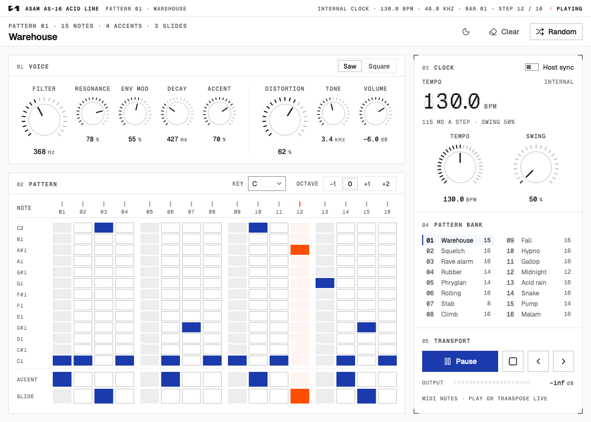
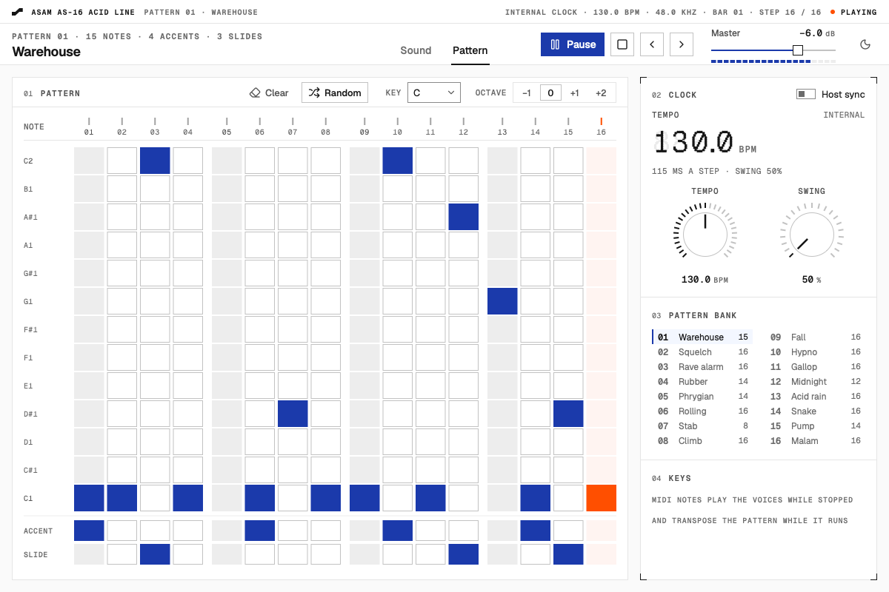

<h1>
  <picture>
    <source media="(prefers-color-scheme: dark)" srcset=".github/assets/asam-logo-white.svg">
    
  </picture>
</h1>

> *Asam* (Indonesian): sour, and the word for acid. Here, a distorted acid line you can play without opening a DAW.

Asam is a monophonic acid bass synthesizer with a live step sequencer, by 21 Strive. It builds as a **VST3**, an
**Audio Unit** and a **standalone app** for macOS on JUCE 9, and its interface is drawn in
[Rapi](https://github.com/21strive/rapi), the 21 Strive design language.

Each voice is the classic bassline machine (a saw or a square into a diode ladder filter, with accent and slide), pushed
through its own distortion stage the way distorted acid techno does it, and up to three of them play every note. Two knobs do most of the work: **Filter** opens and closes the low-pass, **Distortion** sets how hard it clips. The
sequencer plays inside one octave, because acid lines rarely need more.

- Plays on its own: pick a pattern, set the tempo, press Space, and play the computer keyboard on top.
- 16 original patterns, a random pattern maker, and a grid to draw your own: 16 steps, 13 notes, accent and slide.
- Three voices layer every note. Only Voice 1 sounds at first; Voices 2 and 3 wait greyed out until you switch them on.
  Each has its own waveform, unison, filter, envelope with Release, Distortion, Tone and Volume.
- Each voice's filter is a graph you play directly, as in a filter plug-in: low-pass (the ladder), band-pass, high-pass
  or notch, with the cutoff and resonance on a point you drag. While the voice sounds, a second curve shows where the
  envelope has the filter at that moment.
- Unison stacks 3, 5 or 7 detuned oscillators in a voice and spreads them across the stereo field; left and right each
  get their own filter, so the width survives it. With one oscillator the line stays the classic mono acid.
- Two pages: **Sound** holds the three voices, **Pattern** the grid, the clock and the bank. The transport and the master
  volume sit in the header on both.
- Inside a DAW it follows the host tempo and transport. MIDI notes play the voice while the sequencer is stopped and
  transpose the pattern while it runs.
- The oscillator, the filter and the clipper run oversampled (4× at 44.1 and 48 kHz), so resonance and distortion stay
  clean.
- Every knob can be automated, and the pattern is saved with the session.
- The interface follows Rapi: semantic tokens, Geist type, the RKnob geometry, the layout of Rapi's step sequencer
  sample, light and dark themes.

In Rapi's terms Asam earns its screen twice over: a filter is tuned faster by hand than in words, and a rhythm is drawn
on a grid faster than it could ever be described.

<picture>
  <source media="(prefers-color-scheme: dark)" srcset="docs/asam-dark.png">
  
</picture>

<picture>
  <source media="(prefers-color-scheme: dark)" srcset="docs/asam-pattern-dark.png">
  
</picture>

## Build (macOS)

Requires Xcode or the Command Line Tools, and CMake 3.22 or newer. JUCE is a submodule.

```bash
git clone --recursive https://github.com/21strive/asam.git
cd asam
cmake -B build -G Ninja -DCMAKE_BUILD_TYPE=Release   # without Ninja, leave out -G Ninja
cmake --build build --target Asam_VST3 Asam_AU Asam_Standalone
```

If the clone was not recursive, fetch JUCE with `git submodule update --init`. For one binary that runs on Apple Silicon
and Intel, add `-DCMAKE_OSX_ARCHITECTURES="arm64;x86_64"` when configuring.

| Format     | Built at                                           | Copied to                              |
|------------|----------------------------------------------------|----------------------------------------|
| VST3       | `build/Asam_artefacts/Release/VST3/Asam.vst3`      | `~/Library/Audio/Plug-Ins/VST3`        |
| AU         | `build/Asam_artefacts/Release/AU/Asam.component`   | `~/Library/Audio/Plug-Ins/Components`  |
| Standalone | `build/Asam_artefacts/Release/Standalone/Asam.app` | —                                      |

## What Asam decides

| Layer | Decision |
|---|---|
| Voices | Three, all playing every note, each with its own oscillator, filter, envelopes, distortion and level; only voice 1 sounds at first. A voice fades in or out over a few milliseconds when it is switched, and one switched back on joins in phase with the others |
| Oscillator | Saw or square, band-limited with PolyBLEP; the square's fundamental sits in phase with the saw's, so layered voices add up |
| Unison | 1, 3, 5 or 7 free-running oscillators, detuned up to ±50 cents and panned equal-power; the centre voice never moves, so one voice is the mono line exactly |
| Filter | Four-pole diode ladder (RC-ladder topology), solved per sample with zero-delay feedback; the resonance loop runs through a 150 Hz high-pass so the low end survives, and a tanh stage saturates it. One ladder per side when the voice is wide. Band-pass, high-pass and notch use a trapezoidal state variable filter swept by the same envelope and accent; changing the mode crossfades over 8 ms. The graph draws each mode's linear response from the same equations |
| Envelopes | Filter decay from 200 ms to 2.5 s; a fast VCA with a release from 16.5 ms (the classic snap) to 3 s |
| Accent | Louder, the shortest decay, and a sweep capacitor that pushes the cutoff; consecutive accents stack |
| Slide | Fixed-time glide (about 40 ms) with the gate held through the step |
| Distortion | One per voice, after its filter: input high-pass and high-frequency emphasis, an asymmetric tanh stage into a hard-knee clipper, a tone low-pass and makeup gain; from just under unity to +48 dB |
| Oversampling | 4× up to 48 kHz, 2× up to 96 kHz, none above; the voices always run near 192 kHz |
| Sequencer | 16 steps, sample-accurate, gate at half a step, swing 50–75 %, its own clock at 60–200 BPM or the host's |
| Patterns | One octave: 13 notes, every step a note or a rest, with accent and slide |
| Output | Each voice's level comes after its distortion; the voices are summed, then the master volume. Stereo; a mono line lands identically on both sides, a mono bus gets the sum. A soft knee keeps it under 0 dBFS |
| Interface | Rapi 0.2: semantic roles only, square controls, 1 px rules, Geist, Geist Mono and one Geist Pixel readout |
| Formats | VST3, AU and a standalone app on JUCE 9.0.5 |

## Playing it

### Sound page

Each of the three voices has the same controls:

| Control | What it does |
|---|---|
| On | The switch at the head of the voice. Only Voice 1 is on at first; click anywhere on a greyed-out voice, or on its row in the console's **Voices** list, to switch it on. |
| Saw / Square | Oscillator waveform. |
| Unison | How many oscillators: 1, 3, 5 or 7. One is the classic mono line. |
| Detune | How far apart the unison oscillators are tuned, up to ±50 cents. |
| Width | How far they spread across the stereo field. |
| Filter mode | **LP** is the diode ladder; **BP**, **HP** and **Notch** are a resonant band-pass, high-pass and notch. |
| **Filter graph** | The response of the chosen mode, 20 Hz to 20 kHz. Click to put the cutoff there (40 Hz to 10.2 kHz), drag across to move it and up or down for resonance; Shift for fine, scroll for resonance, double-click to reset. With focus, the arrows move the cutoff a semitone and the resonance a percent. |
| Env mod | How far the envelope opens the filter on every note, up to 4.5 octaves. Turn it to zero for a filter that stays where you put it, such as a high-pass held at 1 kHz. |
| Decay | Length of the filter sweep. |
| Release | How long a note rings after its gate closes, from the classic 16.5 ms snap to 3 s. |
| Accent | How much accented steps jump out. |
| **Distortion** | How hard the voice is driven, from clean to full fuzz. The level is compensated, so the knob changes character more than loudness. |
| Tone | Low-pass after the distortion, 1.2 to 12 kHz, from dark to screaming. |
| Volume | The voice's level in the mix, after its distortion, from silent to +6 dB. |

**Master** in the header sets the output level of the three together, with the output meter under it.

### Sound presets

- The Sound page's header names the sound in use. The chevron beside the name opens the presets you have saved, and
  **Save**, **Save as…**, **Open…**, **Init sound** and **Show presets folder**. **Save** writes over the preset in use;
  a sound that has no file yet asks for a name. **Edited** shows once a knob moves away from the preset.
- A preset holds the sound only: the three voices and the master volume. Loading one never changes the pattern, the
  tempo or the key.
- Presets are plain XML files ending in `.asam`, kept in `~/Library/Audio/Presets/21 Strive/Asam/` and shared by the
  standalone app and the plug-ins. They open in any text editor and can be sent to someone else. A preset saved by an
  older Asam opens with any knob it does not know at its default.
- Inside a DAW, the host's own preset menu works too (it saves Asam's whole state, pattern included).

### Pattern page

- Click a cell to put a step on that note, click it again for a rest, drag to draw. The root is the bottom row and its
  octave the top row.
- **Accent** and **Slide** have their own rows. Slide on a step holds the gate and glides into the next step.
- The **pattern bank** holds 16 patterns (Warehouse, Squelch, Rave alarm, Rubber, Phrygian, …). **Random**, in the
  pattern's head, writes a new line in minor pentatonic or phrygian; **Clear** empties the grid.
- **Key** and **Octave** move the whole pattern. **Tempo** and **Swing** sit on the clock.
- **Transport** sits in the header on both pages, so the line keeps playing while you shape the voices.
- **Transport**: play or pause, stop and rewind to step 1, previous and next pattern.
- The page you were on is saved with the session.

### Keys in the standalone app

| Key | Action |
|---|---|
| `Space` | Play or pause |
| `←` `→` | Previous or next pattern |
| `A W S E D F T G Y H U J K` | One octave of notes, C to C; while the pattern runs they transpose it |
| `Shift` + a note | An accented note |
| `Z` `X` | Keyboard octave down or up |
| `Cmd` `S` | Save the sound preset |
| `Shift` `Cmd` `S` | Save the sound as a new preset |
| `Cmd` `O` | Open a sound preset |

The settings button in the header opens the audio and MIDI settings. Every MIDI input opens on launch, so a keyboard
plays straight away.

### In a DAW

- **Host sync** is on by default: press **Play** to arm the sequencer, and it runs while the host plays. Turn Host sync
  off to run Asam's own clock.
- While the sequencer is stopped, MIDI notes play the voice: overlapping notes slide, velocity 100 and above is an
  accent. While it runs, notes transpose the pattern relative to C3 (MIDI 60).
- Space, the arrows and the letter keys are left to the host.

## Project layout

```
CMakeLists.txt
Source/
  PluginProcessor.*       audio, sequencer, MIDI, state
  PluginEditor.*          the interface: strip, header with the tabs, transport and master volume, the voice panels
                          with their filter graphs, the grid, and the clock, bank and keys console
  StandaloneApp.cpp       the standalone app: native title bar, MIDI inputs opened on launch
  Params.*                parameters and how their values read
  SoundPreset.*           sound presets: the .asam file, saving and loading
  dsp/                    DiodeLadder, AcidVoice, AcidDrive, small filters
  seq/                    patterns and the preset bank
  ui/                     Rapi for JUCE: tokens, type, Lucide icons, widgets, the step grid, look and feel
Resources/Fonts/          Geist, Geist Mono and Geist Pixel (SIL OFL 1.1)
Resources/Icon/           the macOS app icon and the Swift script that draws it
Tests/AsamCheck.cpp       offline checks
ThirdParty/JUCE/          JUCE 9.0.5 (submodule)
docs/                     screenshots
```

## Checks

`AsamCheck` renders the synth offline and checks it, without a host or an audio device:

```bash
cmake --build build --target AsamCheck
./build/AsamCheck_artefacts/Release/AsamCheck <output-folder>
```

It measures the filter (where the resonance peak lands, stability at full resonance), renders every pattern to WAV and
checks for NaN, clipping and DC, sweeps the Distortion knob for level, runs at 44.1, 96 and 192 kHz, round-trips the
saved state, checks the voices (switching them, the four filter modes and their levels, each voice's own distortion,
Release, sessions saved before there were three voices), checks that the filter graph draws what the filter does and
that a click on its 1 kHz line sets 1 kHz, saves and loads sound presets (sound only, defaults for what a file leaves
out, foreign files refused), and writes both pages to PNG in both themes. The Audio Unit also passes `auval -v aumu Asm6 Strv`.

## Credits

The 21 Strive brand book defines the marks, colours and type, and Rapi the language of the interface. Geist, Geist Mono
and Geist Pixel are by Vercel with basement.studio, under the SIL Open Font License. Icons are from Lucide (ISC).
The patterns are original.

JUCE is dual-licensed under the AGPLv3 and the commercial JUCE licence; releasing Asam as closed or commercial software
needs a commercial JUCE licence (see `ThirdParty/JUCE/LICENSE.md`).
